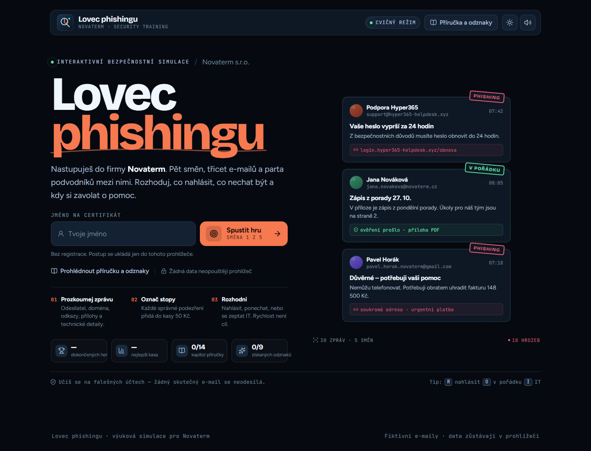
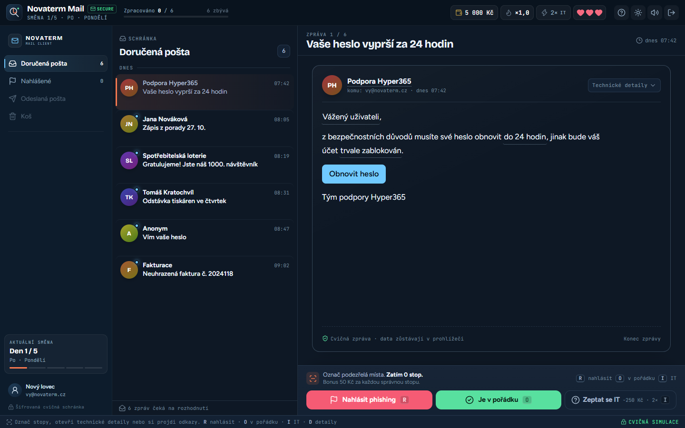

# 🎣 Lovec phishingu

**Výuková hra o rozpoznávání e-mailového phishingu.** Pět směn, třicet zpráv, tři životy důvěry a jedna fiktivní firma **Novaterm**.

[**▶ Hrát hru**](https://lovec-phishingu.trentin.cz) · [Cloudflare Pages zrcadlo](https://lovec-phishingu.pages.dev)



## Co to je

Hráč nastoupí do fiktivní firmy Novaterm a během pěti pracovních dnů prochází cvičnou e-mailovou schránkou. U každé zprávy rozhoduje, zda ji nahlásí jako phishing, ponechá jako legitimní, nebo si vyžádá pomoc IT.

Hra učí číst celou e-mailovou adresu, ověřovat odkazy a přílohy, všímat si nátlaku a rozlišovat skutečnou komunikaci od podvodu. Všechno se děje v bezpečné simulaci — žádný odkaz se nikam neodesílá a žádná data neopouštějí prohlížeč.

Celkem hra obsahuje **30 ručně napsaných e-mailů** — 18 phishingových a 12 legitimních. Všechny adresy, domény i firmy jsou smyšlené.

## Pro koho

- studenti středních a vysokých škol,
- zaměstnanci v rámci security awareness školení,
- kdokoli, kdo si chce v bezpečném prostředí vyzkoušet rozhodování pod tlakem.

Hra je vhodná pro samostatné hraní i pro společnou hru ve dvojici, kdy jeden čte zprávu a druhý rozhoduje.

## Co si hráč odnese

- Rozpozná podvrženou doménu, podezřelý odkaz, nebezpečnou přílohu i falešnou přihlašovací stránku.
- Naučí se číst hlavičku odesílatele, adresu pro odpověď a výsledek SPF/DKIM.
- Vyzkouší si CEO fraud, změnu bankovního účtu, QR phishing, vydírání, falešnou podporu a další scénáře.
- Zažije důsledky falešného poplachu i naletění na podvod — bez reálných následků.
- Na konci získá certifikát s hodností, statistikami a odznaky.

## Jak hrát



1. **Prozkoumej zprávu.** Otevři technické detaily, sleduj celou adresu za zavináčem, adresu pro odpovědi a výsledek ověření.
2. **Označ stopy.** Klikni na podezřelý text, adresu, odkaz nebo přílohu. Každá správná stopa u phishingové zprávy přidá 50 Kč.
3. **Rozhodni.** Nahlásit phishing, ponechat zprávu jako v pořádku, nebo se zeptat IT. Odpověď IT stojí 250 Kč a jednu ze dvou nápověd na směnu.
4. **Pokračuj.** Po vyhodnocení si přečti vysvětlení a pokračuj další zprávou. Na konci směny uvidíš bonusy, nové odznaky a přehled rozhodnutí.

E-maily jsou v každé směně seřazené chronologicky, takže časy a kontext dne do sebe zapadají.

### Bodování

| Akce | Efekt |
| --- | --- |
| Správné nahlášení phishingu | +500 Kč |
| Každá správná stopa | +50 Kč |
| Ponechání legitimní zprávy | +200 Kč |
| Série správných rozhodnutí | až ×1,5 |
| Falešný poplach | −300 Kč |
| Otevření podezřelého odkazu | −500 Kč |
| Naletění na phishing | −1 500 Kč a jeden život |
| Odevzdání údajů na falešné stránce | −2 000 Kč a jeden život |
| Dotaz na IT | −250 Kč |

Směna se uzavírá bonusem za zbývající důvěru a za bezchybný průběh. Po třech ztracených životech lze směnu opakovat.

### Hodnosti, odznaky a příručka

Hra má čtyři hodnosti: **Stážista**, **Strážce schránky**, **Lovec phishingu** a **Mistr obrany**. Nejvyšší hodnost získáš jen tehdy, když projdeš hru bez ztraceného života, falešného poplachu, otevřené pasti, odevzdaných údajů i bez použití nápovědy IT.

Celkem lze získat **9 odznaků** a odemknout **14 kapitol příručky**. Kapitola se odemkne při prvním vyhodnocení daného typu zprávy a zůstane dostupná i během rozehrané směny.

## Co hra obsahuje

- **5 směn × 6 e-mailů** s vlastními scénáři a denním kontextem.
- **Označování stop** přímo v těle zprávy, v technických detailech i u příloh.
- **Simulované webové stránky** — falešná přihlášení, platební formuláře a makra. Nic se nikam neodesílá, formuláře jsou jen atrapy.
- **Technické detaily** včetně celé adresy, Reply-To a SPF/DKIM.
- **Příručku, archiv odznaků a statistiky** s ukládáním do `localStorage`.
- **Příručku dostupnou i během hry** přes nápovědu; rozehraná směna zůstane zachovaná.
- **Dva vizuální režimy** — tmavý a světlý.
- **Zvuky, konfety, přechody a mikroanimace** s respektem k `prefers-reduced-motion`.
- **Klávesové zkratky** ve hře: `R` nahlásit, `O` v pořádku, `I` IT, `D` technické detaily, `N` další zpráva.
- **Responzivní rozvržení** pro desktop i mobil.
- **Přístupnost** — focus trap v dialogových oknech, viditelný focus, `aria-live` oznámení a popisky ovládacích prvků.

## Ovládání

| Klávesa | Akce |
| --- | --- |
| `R` | Nahlásit phishing |
| `O` | Označit jako v pořádku |
| `I` | Zeptat se IT |
| `D` | Zobrazit/skrýt technické detaily |
| `N` | Další zpráva |

Zkratky fungují jen ve hře a jsou vypnuté, když je otevřené dialogové okno nebo formulářové pole.

## Spuštění

```bash
npm install
npm run dev
```

Otevři adresu, kterou vypíše Vite (obvykle `http://localhost:5173`).

### Produkční build

```bash
npm run build
npm run preview
```

Výsledek je v `dist/`. Aplikace používá relativní cesty, takže ji lze nasadit do libovolné statické složky nebo na běžný hosting. Pro otevření přímo z disku je potřeba lokální server — prohlížeče blokují ES moduly na `file://`.

## Nasazení

### Cloudflare Pages

Projekt je připravený pro přímé nahrání přes Wrangler:

```bash
npx wrangler login
npm run deploy
```

První příkaz přihlásí Wrangler k Cloudflare. `npm run deploy` nejdřív spustí produkční build a potom nahraje `dist/` do Pages projektu `lovec-phishingu`. Pro náhledovou větev použij `npm run deploy:preview`.

Konfigurace je v `wrangler.toml`; bezpečnostní hlavičky a cachování statických assetů řeší `public/_headers`, který se kopíruje do `dist/_headers`.

Pokud projekt v Cloudflare ještě neexistuje, vytvoř ho před prvním nasazením:

```bash
npx wrangler pages project create lovec-phishingu --production-branch main --force
```

`--force` obchází novou delegaci Wrangleru na Cloudflare Workers a vytvoří klasický Pages projekt. U existujícího projektu ho už nepotřebuješ.

### Vlastní doména

Produkční verze běží na [lovec-phishingu.trentin.cz](https://lovec-phishingu.trentin.cz). Doména je připojená k Pages projektu v Cloudflare; po dalším `npm run deploy` se změny projeví i tam.

## Struktura

```text
src/
  App.tsx                 – přepínání obrazovek, zvuky, konfety, klávesy
  game/
    content.ts            – 30 e-mailů, typy podvodů, směny, odznaky
    reducer.ts            – herní logika a stav
    logic.ts              – vyhodnocení, hodnosti, statistiky
    storage.ts            – ukládání profilu
    audio.ts              – Web Audio zvuky
    qr.ts                 – generování simulovaného QR kódu
  components/             – HUD, schránka, čtečka, dialogy, modaly
  screens/                – titulka, briefing, hra, konec směny, certifikát, archiv
  styles/                 – design systém, obrazovky, herní plocha
public/                   – favicon a HTTP hlavičky
docs/screenshots/         – náhledy pro dokumentaci
legacy/                   – původní jednosouborová verze (jen pro porovnání)
```

## Soukromí a etika

- Žádná data se neodesílají na server. Postup se ukládá pouze do `localStorage` v prohlížeči.
- Falešné přihlašovací a platební formuláře jsou pouze vizuální simulace; nemají odesílací logiku.
- Všechny e-maily, domény a firmy jsou fiktivní.
- Fonty jsou součástí buildu (Fontsource), aplikace neposílá žádné externí požadavky.
- Hra není náhradou skutečného bezpečnostního školení ani phishingového testu. Je to cvičná simulace pro pochopení principů.

## Vývoj a kontrola

```bash
npm run build   # TypeScript kontrola + produkční build
npm run preview # lokální náhled produkčního buildu
```

Před odevzdáním je vhodné projít:

- celou hru od první do poslední směny,
- obě barevné varianty,
- mobilní šířku 390 px a desktop 1440 px,
- klávesové zkratky a dialogová okna,
- reset postupu v archivu,
- chování při vypnutém zvuku a při `prefers-reduced-motion`.

## Původní verze

Původní jednosouborová verze je pro porovnání uložená v `legacy/lovec-phishingu-v1.html`. **Aktuální aplikace se spouští z `index.html`** přes Vite; historický soubor není součástí produkčního buildu ani ho nepoužívej pro hodnocení.

## Technologie

React 19, TypeScript, Vite, Framer Motion, Immer, canvas-confetti, Lucide a Fontsource. Nasazení na Cloudflare Pages přes Wrangler.
